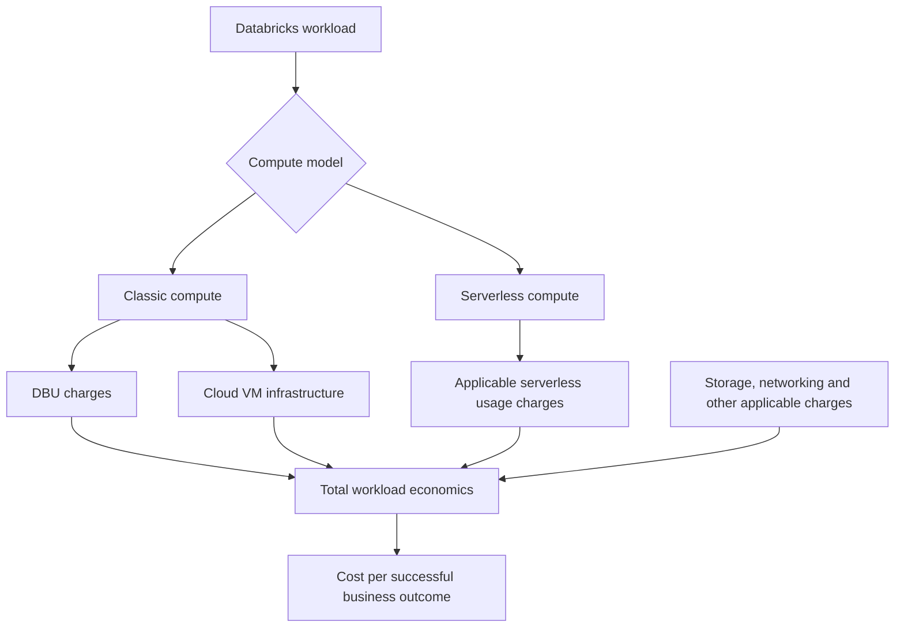
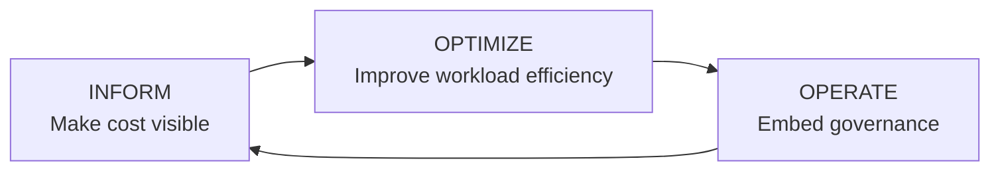

# Beyond DBUs: Understanding and Optimizing the True Cost of Azure Databricks

*An engineering-led field guide to identifying compute waste, making
cost-aware architectural decisions, and optimizing lakehouse workloads
without compromising SLAs.*

**Platform scope:** This article focuses on Azure Databricks running on Microsoft Azure. Pricing, SKU availability, serverless support, VM families, and Spot behavior vary by Azure region, workspace plan, subscription, and feature rollout. Treat the recommendations as decision frameworks, not universal settings. Verify eligibility and current pricing for the target environment before implementation.

**Target audience:** Data Engineering Leads, Databricks Architects, Platform Engineers, Technical Leads, and Analytics Teams.

**How to read the examples:** All monetary figures in this article are synthetic illustrations created to explain the calculations. They are not Azure quotes, customer invoices, or measured Databricks benchmarks. SQL examples are based on published Azure Databricks schemas and documentation; they should still be run and reviewed in the target workspace before being used operationally.

> **Core principle:** Cost optimization is not about choosing the
> cheapest compute. It is about delivering the required business outcome
> at the lowest sustainable cost while maintaining performance,
> reliability, and service-level agreements (SLAs).

------------------------------------------------------------------------

## 1. The Month-End Billing Shock

It is a situation every data platform lead eventually encounters.

Your data engineering team is delivering features faster than ever. Data
pipelines are executing on schedule, dashboards are refreshing, Delta
tables are processing incremental loads, and analytical workloads are
performing as expected.

Then the monthly cloud infrastructure bill arrives.

Databricks consumption has increased significantly. Cloud infrastructure
expenditure is growing faster than expected, and finance wants to
understand why the data platform budget is increasing despite relatively
stable business workloads.

The immediate reaction is usually to investigate the Spark code:

-   Are the joins inefficient?
-   Are we processing unnecessary data?
-   Should we reduce the number of workers?
-   Is the cluster size too large?

These are valid questions, but they address only part of the problem. In
many environments, the underlying issue is not necessarily inefficient
Spark code. It is a combination of compute selection, resource
provisioning, workload scheduling, data architecture, and inadequate
cost visibility.

### Understanding the True Databricks Cost Equation

The first step towards cost optimization is understanding which charges
are visible on the Databricks bill and which are billed separately by
Azure. The exact composition depends on the compute product and
architecture.

For **classic Azure Databricks compute**, a useful cost model is:

$$
\text{Workload Cost} = \text{Databricks DBU Charges} + \text{Azure VM Charges} + \text{Other Applicable Azure Charges}
$$

Other charges can include managed disks, storage, networking, data
transfer, NAT Gateway, Private Link, and other services used by the
solution. Which charges apply depends on the deployment. Azure's pricing
page describes classic compute as charging for both provisioned VMs and
DBUs ([Azure Databricks pricing](https://azure.microsoft.com/en-us/pricing/details/databricks/)).

For **serverless compute**, Databricks manages the compute infrastructure
and the customer is billed under the applicable serverless usage model.
Do not add a customer-managed worker VM line item to a serverless DBU
estimate: the serverless compute infrastructure is not provisioned as
customer-managed VMs in the Azure subscription. However, serverless does
not mean that every related Azure charge disappears. Depending on the
architecture, networking, data transfer, storage, NAT Gateway, Private
Link, and other dependent services can still contribute to total cost.
Check the pricing page for the applicable serverless SKU and charge
components for the region and product in use.

The distinction matters: optimizing DBU consumption alone does not
necessarily produce an equal percentage reduction in total platform
expenditure.

**Illustrative monthly expenditure — classic-compute example**

| Cost component | Monthly expenditure | Contribution |
|---|---:|---:|
| Databricks DBUs | $12,000 | 48% |
| Azure VM infrastructure | $8,000 | 32% |
| Storage | $3,000 | 12% |
| Networking and other applicable services | $2,000 | 8% |
| **Total** | **$25,000** | **100%** |

*Illustrative figures only. They are not Azure list prices, a customer
invoice, or a measured environment. This decomposition is for a
classic-compute architecture; it is not a serverless pricing example.*

**Evidence label — Illustrative scenario:** The values above are
hypothetical. The classic-versus-serverless billing distinction is
**Documented behavior** in the Azure Databricks and Azure pricing
references listed at the end of this article.

A reduction in DBUs does not automatically produce the same percentage
reduction in the overall infrastructure bill. A credible FinOps review
therefore separates (at minimum) Databricks DBUs, Azure VM charges,
storage, networking, and other dependent services. It should also distinguish **Azure/Databricks
list-price estimates**, negotiated or private-offer rates, and actual
invoiced amounts.

For historical DBU list-price estimates, use the effective-dated
`system.billing.list_prices` table rather than hardcoding a DBU rate. The
following is a starting point for DBU list-price estimation:

```sql
SELECT
    u.usage_date,
    u.workspace_id,
    u.sku_name,
    u.usage_unit,
    lp.currency_code,
    SUM(u.usage_quantity * lp.pricing.effective_list.default)
        AS estimated_dbu_list_cost
FROM system.billing.usage AS u
JOIN system.billing.list_prices AS lp
    ON lp.sku_name = u.sku_name
   AND lp.cloud = 'AZURE'
   AND u.usage_end_time >= lp.price_start_time
   AND (lp.price_end_time IS NULL
        OR u.usage_end_time < lp.price_end_time)
WHERE u.cloud = 'AZURE'
  AND u.usage_unit = 'DBU'
  AND u.usage_date >= DATE_SUB(CURRENT_DATE(), 29)
  AND u.usage_date <= CURRENT_DATE()
GROUP BY
    u.usage_date,
    u.workspace_id,
    u.sku_name,
    u.usage_unit,
    lp.currency_code
ORDER BY u.usage_date DESC, estimated_dbu_list_cost DESC;
```

**Important interpretation:** This estimates DBU list-price value from
Databricks billing system tables. The usage table can contain retraction
and restatement records when billing corrections occur; summing usage
quantities preserves the net corrected amount. It is not a complete
Azure TCO query, does not include separately billed VM or networking
charges, and is not a substitute for the final invoice or contracted
rate card. Validate that the SKU, usage-unit, and currency filters match
the products in your workspace. Billing records are typically available
within 12 hours, so this is not a real-time meter.

**Reconcile estimates before presenting a platform cost:**

1. Use the same billing period, timezone boundary, workspace scope, and
   currency for Databricks usage and Azure cost exports.
2. Reconcile DBU list-price estimates against the contracted Databricks
   rate card or invoice. Do not assume public list prices equal the
   organization's negotiated rates.
3. Use Azure Cost Management exports to identify VM, disk, storage,
   networking, NAT Gateway, Private Link, and other Azure resource costs
   attributable to the platform. Apply resource tags and resource-group
   boundaries consistently.
4. Identify shared resources and decide how their costs are allocated;
   document the allocation method rather than silently assigning all
   shared spend to one workload.
5. Reconcile credits, discounts, marketplace adjustments, taxes, and
   currency conversion with the actual billing statement before
   publishing a customer-specific figure.

The result should distinguish **DBU list-price estimate**, **Azure
infrastructure cost**, **contracted cost**, and **invoiced cost**. These
are related but are not interchangeable measures.

A sustainable cost optimization strategy must answer three questions:

1. **Cost visibility:** Where is the money being spent?
2. **Engineering efficiency:** Why are workloads consuming those
   resources?
3. **Cost governance:** What prevents the same inefficiencies from
   returning?

These three dimensions form the foundation of engineering-led FinOps.

> **Evidence status — documented behavior:** Azure Databricks exposes
> billable usage through `system.billing.usage` and historical SKU list
> prices through `system.billing.list_prices` ([billable usage schema](https://learn.microsoft.com/en-us/azure/databricks/admin/system-tables/billing), [pricing system table](https://learn.microsoft.com/en-us/azure/databricks/admin/system-tables/pricing)). Azure pricing documents
> separate VM and DBU charges for classic compute and separate
> serverless pricing models. The example breakdown above is illustrative,
> not measured.

### Cost economics at a glance



------------------------------------------------------------------------

## 2. The Seven Silent Compute Money Pits

Before introducing optimization policies, we need to understand where
unnecessary expenditure originates.

In enterprise Databricks environments, cost inefficiencies are not
always caused by large production workloads. They can emerge from
seemingly harmless configuration defaults, poor workload design, and
architectural decisions that accumulate over time.

### Pitfall 1: Using All-Purpose Compute for Production Workloads

**The anti-pattern**

A team develops a notebook, attaches it to a shared interactive cluster,
and eventually schedules the same notebook as a production workflow. The
pipeline works, but the compute resource was selected for interactive
development rather than automated execution.

**The financial impact**

Interactive compute and automated job compute can have different DBU
pricing structures. A shared interactive cluster may also remain active
after the scheduled workload has completed, resulting in unnecessary DBU
and infrastructure expenditure.

**The engineering recommendation**

Evaluate compute based on workload characteristics.

| Workload | Recommended starting point |
|---|---|
| Interactive development | Serverless or governed interactive compute |
| Supported scheduled workloads | Serverless Jobs Compute |
| Jobs requiring custom configurations | Classic Jobs Compute |
| SQL-based analytics | Appropriate SQL Warehouse |
| Production scheduled workflows | Avoid using All-Purpose Compute as the default |

Azure Databricks currently recommends serverless compute for most
automated workloads where the task type, region, workspace, and feature
requirements are supported. Classic Jobs Compute remains relevant for
non-SQL jobs that require custom cluster settings unavailable in
serverless. Spark Submit is a documented example for which classic Jobs
Compute is the supported option. Classic All-Purpose Compute is
generally not optimized for automated workloads.

The important lesson is that production workloads should have compute
configurations designed for their execution requirements, not simply
reuse whatever compute is already available.

### Pitfall 2: Poor Auto-Termination and Idle Compute Management

**The anti-pattern**

Developers create interactive clusters with generous auto-termination
settings. Some leave notebooks attached overnight, while others create
clusters for temporary investigations and forget to terminate them. In
shared environments, external monitoring processes or interactive usage
may also keep resources active longer than intended.

**The financial impact**

Consider a hypothetical development cluster that remains billed for two
additional hours after its last useful operation. Across several teams
and multiple workspaces, these idle periods can accumulate into
significant expenditure.

For classic compute, both DBU consumption and underlying VM
infrastructure may continue to accrue while the cluster is running.

**The engineering recommendation**

Introduce different auto-termination policies based on workload type.

| Environment | Suggested starting point |
|---|---:|
| Individual development | 10–15 minutes |
| Shared interactive analytics | 15–30 minutes |
| Production scheduled jobs | Job lifecycle-based termination |
| Long-running streaming | Workload-specific lifecycle management |

These are engineering starting hypotheses, not product-mandated values or universal defaults. Validate them against developer workflow, cluster start-up latency, policy requirements, and the actual idle-cost profile. Account for startup costs, user activity, and workload requirements. Establish automated
monitoring for idle compute rather than depending entirely on developers
to terminate clusters manually.

### Pitfall 3: Incorrect Cluster Sizing and Driver-Worker Asymmetry

**The anti-pattern**

An engineer provisions a large cluster because the dataset is expected
to grow. A relatively simple ingestion workload is assigned memory-heavy
instances with many workers, even though the workload does not require
those resources. Similarly, the driver may be oversized despite minimal
driver-side processing.

**The financial impact**

The organization pays for provisioned resources, not simply the
resources that Spark actually utilizes. A cluster can have substantial
available memory and CPU capacity while executing relatively small
transformations.

However, low CPU utilization alone does not prove that a cluster is
oversized. A workload may be waiting for I/O, network operations,
shuffle processing, or external dependencies.

**The engineering recommendation**

Cluster sizing should be based on actual workload metrics:

-   CPU utilization across driver and worker nodes.
-   Memory utilization and memory pressure.
-   Shuffle read and write volumes.
-   Spill to disk.
-   Executor utilization.
-   Task duration and skew.
-   Autoscaling behavior.

Databricks provides `system.compute.node_timeline`, which exposes
node-level utilization information.

**Diagnostic SQL — hourly utilization summary**

Azure Databricks documents `system.compute.node_timeline` as a
minute-granularity table with one record per instance and minute. It
includes `workspace_id`, `cluster_id`, `instance_id`, `start_time`,
`driver`, `cpu_user_percent`, `cpu_system_percent`,
`cpu_wait_percent`, `mem_used_percent`, and `mem_swap_percent`. The
query below first rolls up the node-minute rows, then summarizes those
minute-level values by hour and driver/worker role.

```sql
WITH minute_metrics AS (
    SELECT
        workspace_id,
        cluster_id,
        DATE_TRUNC('MINUTE', start_time) AS minute_start_utc,
        driver,
        COUNT(DISTINCT instance_id) AS nodes_reporting,
        AVG(cpu_user_percent + cpu_system_percent) AS avg_cpu_busy_pct,
        MAX(cpu_user_percent + cpu_system_percent) AS peak_node_cpu_busy_pct,
        AVG(cpu_wait_percent) AS avg_cpu_wait_pct,
        AVG(mem_used_percent) AS avg_memory_used_pct,
        MAX(mem_swap_percent) AS max_memory_swap_pct
    FROM system.compute.node_timeline
    WHERE start_time >= CURRENT_TIMESTAMP() - INTERVAL 7 DAYS
    GROUP BY
        workspace_id,
        cluster_id,
        DATE_TRUNC('MINUTE', start_time),
        driver
)
SELECT
    workspace_id,
    cluster_id,
    DATE_TRUNC('HOUR', minute_start_utc) AS usage_hour_utc,
    driver,
    COUNT(*) AS observed_minutes,
    ROUND(AVG(nodes_reporting), 2) AS avg_nodes_reporting,
    ROUND(AVG(avg_cpu_busy_pct), 2) AS avg_cpu_busy_pct,
    ROUND(MAX(peak_node_cpu_busy_pct), 2) AS peak_node_cpu_busy_pct,
    ROUND(AVG(avg_cpu_wait_pct), 2) AS avg_cpu_wait_pct,
    ROUND(AVG(avg_memory_used_pct), 2) AS avg_memory_used_pct,
    ROUND(MAX(max_memory_swap_pct), 2) AS max_memory_swap_pct
FROM minute_metrics
GROUP BY
    workspace_id,
    cluster_id,
    DATE_TRUNC('HOUR', minute_start_utc),
    driver
ORDER BY usage_hour_utc DESC, workspace_id, cluster_id, driver;
```

**How to interpret the output**

- `driver = true` identifies driver-node observations; `false` identifies
  worker-node observations.
- `avg_nodes_reporting` is the average number of nodes reporting in the
  observed minutes. It is not a provisioned-worker count from the cluster
  configuration history.
- CPU and memory values are averages or peaks of the recorded
  node-minute metrics, not a direct measure of business throughput.
- The `observed_minutes` column helps identify incomplete hourly windows.
- Nodes that ran for less than 10 minutes might not appear in this table.

**Permissions and scope:** System tables require a Unity Catalog-enabled workspace and appropriate Unity Catalog privileges. The documented grant pattern for non-admin users is `USE CATALOG` on the `system` catalog, `USE SCHEMA` on the required system schema, and `SELECT` on the required system schema. Account admins and metastore admins have access by default. The compute system tables are regional and cover classic all-purpose, Jobs, and Lakeflow pipeline compute; they do not provide equivalent node timelines for serverless compute or SQL warehouses. Records are typically available within about one hour, and the node-timeline table has a 90-day default retention period (account-level configurable retention may change this). Nodes that run for less than 10 minutes might not appear. See the [system-table access guidance](https://learn.microsoft.com/en-us/azure/databricks/admin/system-tables/#grant-access-to-system-tables) and [compute system tables reference](https://learn.microsoft.com/en-us/azure/databricks/admin/system-tables/compute).

**Operational note:** This is a documentation-aligned diagnostic query,
not a pre-executed script. Validate it against the target workspace's
regional system-table data, permissions, and coverage before
operationalizing it. Do not present a generated screenshot or sample
output as live evidence unless it was captured from that workspace.

The objective is not to select the smallest possible cluster. It is to
select the smallest appropriate configuration that consistently meets
the workload's performance and reliability requirements.

### Pitfall 4: Assuming Photon Always Reduces Cost

**The anti-pattern**

An engineering team assumes that Photon will always reduce total workload cost, or treats its presence as proof that every operation is accelerated. On current Azure Databricks experiences, Photon is enabled by default for serverless compute and SQL warehouses, and for classic all-purpose, Jobs, and classic Lakeflow pipeline compute. Resources created through APIs may require explicit Photon configuration. The engineering question is therefore whether the workload benefits from Photon—not simply whether a checkbox is enabled.

Photon is Databricks' native vectorized query engine, designed to
accelerate supported SQL and DataFrame workloads. However, not every
operation benefits equally from Photon.

**The financial impact**

Photon instance types consume DBUs at a different rate from the same instance type running the non-Photon runtime. Unsupported operations can fall back to the Spark runtime. Photon accelerates a documented set of operators and expressions; do not assume every stage of every query executes in Photon. Very short queries may see little benefit because planning and scheduling overhead can dominate. See [What is Photon?](https://learn.microsoft.com/en-us/azure/databricks/compute/photon).

The economic question is therefore not simply whether Photon is faster.
It is whether the reduction in execution time and any secondary
benefits outweigh the change in DBU consumption and total applicable
compute charges.

**The engineering recommendation**

Benchmark representative workloads and compare the actual Photon and non-Photon execution paths where both modes are available.

Measure:

1.  Standard execution duration.
2.  Photon execution duration.
3.  DBUs consumed.
4.  Total applicable compute cost.
5.  Percentage of task time spent in Photon, using the Spark UI or query
    profile where available.
6.  End-to-end completion time.

Use Spark UI and query profiles to understand which operations are
actually executed using Photon. For a fair comparison, freeze the input
snapshot, code, runtime, node type, worker bounds, Spark settings, and
concurrency. Run a warm-up followed by multiple measured repetitions in
alternating or randomized order. Compare medians and spread rather than
selecting the fastest run. Keep cache state consistent and verify output
correctness.

A faster execution is not automatically a cheaper execution. The
decision must be based on total workload economics, including DBUs,
Azure VM charges where applicable, and any additional services required
by the workload.

### Pitfall 5: Using 100% On-Demand Workers for Every Batch Workload

**The anti-pattern**

An organization runs every batch processing workload using On-Demand
cloud instances, even when some workloads could tolerate worker
interruptions.

**The financial impact**

Azure Spot VMs use spare Azure capacity and can be evicted when Azure
needs that capacity back. Availability and price vary by VM size, region,
and time. Azure documents no SLA or high-availability guarantee for
Spot VMs and a 30-second eviction notice. For eligible Azure Databricks
classic compute configurations, Spot workers may reduce the VM portion
of expenditure. Databricks DBU charges are a separate component and must
be calculated using the applicable SKU and usage; do not apply the Azure
Spot VM discount to DBU charges. Confirm that the target VM family,
region, cluster configuration, and Databricks compute product support
the intended Spot configuration.

However, worker loss can result in task recomputation, shuffle recovery
overhead, retries, and longer execution times.

**The engineering recommendation**

Evaluate a hybrid compute strategy:

-   **Driver:** On-Demand where appropriate to protect job coordination.
-   **Workers:** Spot where supported and suitable for the workload.
-   **Retry configuration:** Designed to handle interruptions.
-   **Autoscaling:** Configured to maintain reasonable capacity.
-   **SLA:** Validated against actual interruption and recovery
    behavior.

Do not assume that every batch workload is suitable for Spot instances.
For a critical pipeline with a strict completion deadline, the
additional recovery time may outweigh the infrastructure discount.
Use `system.compute.instance_events` to inspect classic-compute placement events and the `availability_type` values (`SPOT` or `ON_DEMAND`). This table is in Public Preview and is regional. It records state transitions and placement, not a complete Spot eviction/recovery ledger; it does not cover SQL warehouses or serverless compute. Correlate placement data with Azure VM/Activity logs and Lakeflow job run history before estimating interruption rates.


**Azure placement audit query**

```sql
SELECT
    workspace_id,
    cluster_id,
    availability_type,
    COUNT(*) AS placement_event_rows,
    COUNT(DISTINCT instance_id) AS distinct_instances_placed
FROM system.compute.instance_events
WHERE event_time >= CURRENT_TIMESTAMP() - INTERVAL 30 DAYS
  AND event_type = 'STATE_TRANSITION'
  AND state = 'INSTANCE_PLACED'
  AND availability_type IN ('SPOT', 'ON_DEMAND')
GROUP BY workspace_id, cluster_id, availability_type
ORDER BY workspace_id, cluster_id, availability_type;
```

This is an event-level placement audit, not a measure of Spot savings or eviction rate. `cluster_id` is populated only for `INSTANCE_PLACED` events. Pair it with Azure VM cost data, Azure activity/eviction evidence, and job run history. The schema and preview status are documented in the [compute system tables reference](https://learn.microsoft.com/en-us/azure/databricks/admin/system-tables/compute).

**How to compare Spot and On-Demand fairly:** Run the same job against the same input snapshot, runtime, node family/size, worker bounds, and concurrency. Alternate the configuration order and repeat the runs. Capture DBUs by SKU, Azure VM charges from Cost Management, placement and eviction evidence, retry counts, shuffle recomputation, total elapsed time, failed attempts, and SLA attainment. Calculate cost per successful business outcome, not just the hourly VM discount. Azure Spot eviction rates and prices vary by region, VM size, and time; the Spot placement system table is not sufficient by itself to establish a reliable eviction rate.

### Pitfall 6: Oversized SQL Warehouses and Poor Concurrency Management

**The anti-pattern**

An organization provisions a large SQL Warehouse to ensure dashboards
and analytical queries respond quickly. Over time, query demand
decreases, but the warehouse configuration remains unchanged. Some
warehouses also remain active longer than necessary.

**The financial impact**

An oversized warehouse can consume more resources than required for its
actual query workload. An undersized warehouse, however, can create
query queues, excessive waiting time, and poor user experience.

**The engineering recommendation**

Review:

-   Warehouse size.
-   Minimum and maximum cluster count.
-   Auto-stop configuration.
-   Query execution duration.
-   Queueing time.
-   Disk spill.
-   Concurrency patterns.
-   Query frequency.

Use query history and warehouse monitoring metrics to understand actual
workload demand.

### Pitfall 7: Inefficient Pipelines and Repeated Job Failures

**The anti-pattern**

A pipeline executes successfully, but the underlying implementation
repeatedly processes unnecessary data.

Examples include:

-   Full refreshes where incremental processing would suffice.
-   Unnecessary repartitioning and shuffling.
-   Repeated data scans.
-   Excessive small-file creation.
-   Poor join strategies.
-   Data skew.
-   Repeated failed job executions.
-   Unnecessary table maintenance operations.

**The financial impact**

A pipeline can use perfectly sized compute and still be expensive
because its processing logic is inefficient. Repeated retries,
unnecessary full refreshes, and excessive data rewriting increase
execution time and resource consumption.

**The engineering recommendation**

Treat Spark performance optimization as part of FinOps.

Prioritize:

1.  Incremental processing instead of unnecessary full refreshes.
2.  Effective partition pruning and predicate pushdown.
3.  Appropriate join strategies.
4.  Reduction of unnecessary shuffles.
5.  Correct handling of skew.
6.  Efficient Delta Lake maintenance.
7.  Sensible retry and recovery configurations.

The most cost-effective cluster cannot compensate for fundamentally
inefficient processing logic.

------------------------------------------------------------------------

## 3. Step 1: Making the Right Architectural Compute Decisions

Once the major cost leakage points have been identified, the next step
is selecting the right architecture for each workload.

There is no single compute configuration that is optimal for every
workload. A configuration that works well for a daily batch ingestion
pipeline may be inappropriate for a highly concurrent SQL analytics
workload.

### Pattern 1: Evaluate Serverless Before Classic Compute

Databricks offers different compute models, including serverless
compute, classic compute, and SQL Warehouses.

For most supported automated workloads, serverless is the recommended
starting point in current Azure Databricks compute-selection guidance.
However, serverless is not a universal replacement for classic compute.
For notebooks, jobs, and Lakeflow pipelines, the workspace must have
Unity Catalog enabled and be in a supported region; the task type must
also be supported by serverless. Spark Submit, for example, uses classic
Jobs Compute. Check the current task-to-compute support matrix, region
availability, workspace plan, networking requirements, and feature
limitations before standardizing on serverless.

| Consideration | Serverless | Classic Compute |
|---|---|---|
| Infrastructure management | Databricks managed | Customer-configured |
| Cluster configuration | Managed settings | Greater configuration control |
| Scaling | Managed automatically | Configurable |
| Customization | Feature-dependent | Greater flexibility |
| Workload suitability | Most supported workloads | Specialized requirements |
| Cost evaluation | Serverless SKU and related Azure charges | DBU plus customer-managed VM and related Azure charges |

**Recommendation:** Benchmark representative workloads before
standardizing on one compute model. For supported scheduled batch jobs,
evaluate serverless when it meets completion and data freshness
requirements. Use performance-optimized modes where faster execution is
operationally necessary.

### Pattern 2: The Hybrid Spot Worker Strategy

For eligible classic compute workloads, use a hybrid approach where the
driver and workers have different availability requirements.

The driver coordinates Spark execution, while workers execute
distributed tasks. Worker interruptions can be tolerated in some
workloads through task recomputation and recovery mechanisms, but they
are not free.

Evaluate Spot usage against:

-   Actual cloud discount.
-   Worker interruption frequency.
-   Shuffle recovery.
-   Retry overhead.
-   End-to-end runtime.
-   Business completion deadline.

Measure total workload cost rather than reporting infrastructure
discounts in isolation.

### Pattern 3: The Photon Qualification Framework

Photon should be evaluated using workload-level benchmarks.

A useful comparison metric is:

$$
\text{Cost Efficiency Ratio} = \frac{\text{Standard Execution Cost}}{\text{Photon Execution Cost}}
$$

For Azure classic compute, include the applicable Databricks DBU and
Azure VM charges in each execution cost. For serverless, use the
applicable serverless usage charge and include any separately billed
networking or dependent Azure services. Keep the pricing basis
consistent: list-price estimate versus contracted/invoiced cost.

Interpretation:

-   Ratio greater than 1: Photon is cheaper for the measured workload.
-   Ratio equal to 1: Both configurations have similar cost.
-   Ratio below 1: Standard execution is cheaper.

For a fair comparison, use the same input snapshot, workload logic,
compute size and configuration, runtime version, concurrency, and
cache state. Run a warm-up, then multiple measured repetitions in an
alternating or randomized order. Record DBUs, VM charges, elapsed time,
query profile, Photon task-time share, and output correctness. Do not
compare a warm cached run against a cold run and call the difference a
Photon gain.

### Pattern 4: Reconsider Traditional Partitioning and Z-Ordering

Traditional Hive-style partitioning can introduce excessive small files,
high partition cardinality, and operational overhead when used without
considering actual query patterns.

Partitioning a large table by a high-cardinality customer identifier,
for example, may create an undesirable physical layout.

Liquid Clustering provides an alternative data-layout strategy for
supported Delta tables. Azure Databricks documents general availability
for Delta Lake tables on Databricks Runtime 15.4 LTS and above. It is
incompatible with Hive-style partitioning and `ZORDER` on the same
table. For existing Delta tables, confirm table eligibility and protocol/client compatibility before enabling it. Liquid Clustering uses Delta writer version 7 and reader version 3; clients that do not support these protocols cannot read the table, and the protocol cannot be downgraded. Before changing a production table, inventory every downstream reader and writer, including older Databricks Runtime jobs, external Delta clients, streaming readers/writers, CDC processes, and data-sharing consumers. Validate their protocol support and plan a rollback or table-recreation strategy; do not assume the table protocol can simply be downgraded. See the [Azure Databricks Liquid Clustering guide](https://learn.microsoft.com/en-us/azure/databricks/tables/clustering) and [Delta feature compatibility reference](https://learn.microsoft.com/en-us/azure/databricks/tables/features/feature-compatibility).

**Illustrative SQL**

```sql
CREATE TABLE silver_ecommerce_orders (
    order_id STRING,
    customer_id STRING,
    order_date DATE,
    total_amount DECIMAL(10,2)
)
USING DELTA
CLUSTER BY (order_date, customer_id);

OPTIMIZE silver_ecommerce_orders;
```

Liquid Clustering is designed to improve data layout and support
incremental optimization without relying on rigid partition structures.

Databricks recommends Liquid Clustering for new tables, but the
expected benefit still depends on table size, data distribution, write
patterns, and query predicates. Very small or infrequently queried
tables may not justify the maintenance work. Compare representative
query profiles, files scanned, bytes read, write latency, and
`OPTIMIZE`/maintenance cost before and after the change.

### Pattern 5: Evaluate Predictive Optimization

Azure Databricks Predictive Optimization can automatically perform
maintenance operations such as `OPTIMIZE`, `VACUUM`, and `ANALYZE` for
supported Unity Catalog managed Delta Lake and Iceberg tables. It does
not apply to external tables. The current Azure prerequisites include a Premium workspace in a supported region, SQL warehouses or Databricks Runtime 12.2 LTS or above, and Unity Catalog managed tables. Current documentation states that Predictive Optimization is enabled by default for accounts created on or after 11 November 2024; enablement for existing accounts was subject to a gradual rollout with completion expected by August 2026. Because account, catalog, schema, and table settings can override inherited values, verify the effective setting in the target environment rather than assuming it is enabled. Check the [current prerequisites and enablement guidance](https://learn.microsoft.com/en-us/azure/databricks/optimizations/predictive-optimization) before relying on it.

This can reduce unnecessary manual maintenance scheduling and allow the
platform to determine when tables benefit from maintenance.

These operations use serverless compute for jobs and are billed using
the serverless jobs SKU. The `system.storage.predictive_optimization_operations_history` table can help inspect operation history and estimated DBU consumption; it is currently documented as Public Preview. Records are typically available within 12 hours. Per-operation DBU allocation can be approximate when several operations share compute, although the total cluster DBU amount is accurate. When multiple operations share
compute, per-operation DBU attribution is estimated. Therefore, assess
both maintenance expenditure and the performance or storage benefits
delivered.

**Illustrative monitoring SQL — estimated DBU usage**

```sql
SELECT
    DATE_TRUNC('DAY', start_time) AS operation_day_utc,
    catalog_name,
    schema_name,
    table_name,
    operation_type,
    operation_status,
    usage_unit,
    SUM(usage_quantity) AS estimated_dbus
FROM system.storage.predictive_optimization_operations_history
WHERE start_time >= CURRENT_TIMESTAMP() - INTERVAL 30 DAYS
  AND usage_unit = 'ESTIMATED_DBU'
GROUP BY
    DATE_TRUNC('DAY', start_time),
    catalog_name,
    schema_name,
    table_name,
    operation_type,
    operation_status,
    usage_unit
ORDER BY operation_day_utc DESC, estimated_dbus DESC;
```

This query reports estimated DBUs, not dollars. The per-operation
allocation can be approximate when several operations share compute,
although the total DBUs for the shared compute are accurate. Confirm
that the Public Preview table is available in the workspace region and
that the required system-table permissions are granted. Review both
successful and failed operations, and compare maintenance activity with
query performance, storage outcomes, and the cost of any manual
maintenance it replaces.

> The objective is not to execute OPTIMIZE more frequently. It is to
> ensure that maintenance operations are performed when they provide
> sufficient value.

------------------------------------------------------------------------

## 4. Step 2: Balancing Cost, Performance and SLAs

One of the biggest misconceptions in data engineering is that cost
optimization simply means reducing compute resources.

Reducing cluster size may lower hourly expenditure, but it may also
increase execution duration, cause SLA failures, or increase retries.

Similarly, choosing expensive compute may improve performance without
providing enough business value to justify the additional cost.

Cost and performance should therefore be evaluated together.

### The Engineering Decision Matrix

| Strategy | Cost implication | Performance implication | Primary consideration |
|---|---|---|---|
| Smaller compute | Lower hourly cost | May increase runtime | SLA compatibility |
| Larger compute | Higher hourly cost | May reduce runtime | Actual workload benefit |
| Photon | Different applicable DBU rate | Can accelerate supported operations | Benchmark total cost |
| Spot workers | Potentially lower VM cost | Interruption and recovery overhead | Fault tolerance |
| Autoscaling | Dynamic resource consumption | Adapts to workload demand | Scaling behavior |
| Liquid Clustering | Maintenance expenditure | Can improve data access | Query and write patterns |
| Predictive Optimization | Billable maintenance compute | Automated table maintenance | Total maintenance economics |

### Introduce Cost Per Successful Workload

A useful metric is the cost of delivering a successful business outcome.
Define the measurement window and workload boundary first. Include the
cost of failed attempts, retries, and required supporting compute in the
numerator; divide by the number of successful executions in that same
window.

$$
\text{Cost per Successful Run} = \frac{\text{Total Workload Cost in the Measurement Window}}{\text{Successful Runs in the Same Window}}
$$

You can also calculate:

-   Cost per million records processed.
-   Cost per terabyte transformed.
-   Cost per successful pipeline execution.
-   Cost per business transaction.
-   Cost per SLA-compliant execution.

**Synthetic cost-per-success example**

The following example uses invented values to demonstrate why failed
attempts belong in the numerator. Assume each period contains 100
successful business executions and 10 failed attempts. In the baseline,
each successful attempt costs 15 illustrative units and each failed
attempt costs 30 units. In the optimized scenario, the corresponding
costs are 13 and 10 units.

| Metric | Baseline | Optimized |
|---|---:|---:|
| Successful business executions | 100 | 100 |
| Failed attempts | 10 | 10 |
| Cost of successful attempts | 1,500 | 1,300 |
| Cost of failed attempts and retries | 300 | 100 |
| **Total workload cost** | **1,800** | **1,400** |
| **Cost per successful execution** | **18.00** | **14.00** |
| Average successful-run duration | 45 min | 32 min |

*All values above are synthetic illustrative cost units, not dollars, Azure prices, Databricks measurements, or realized savings. The example implies a 22.2% reduction in cost per successful execution under its stated assumptions; it does not predict savings for another workload.*

The important point is that the optimized scenario delivers the same
number of successful business outcomes with lower total workload cost
and a shorter successful-run duration. A real comparison must use the
same measurement window, workload boundary, currency, pricing basis,
and success definition in both periods. Include retries, shared-compute
allocation assumptions, and SLA outcomes.

### Four Important FinOps Distinctions

1.  **Cost reduction:** Spending less to deliver the same workload.
2.  **Cost efficiency:** Delivering more output for the same
    expenditure.
3.  **Cost avoidance:** Preventing unnecessary future expenditure.
4.  **Cost optimization:** Improving the overall balance between cost,
    performance, reliability, and business requirements.

These should not be treated as interchangeable metrics.

------------------------------------------------------------------------

## 5. Step 3: Establishing Engineering-Led FinOps Principles

Sustainable Databricks cost management requires more than periodic
infrastructure audits. It needs to become part of the engineering
operating model.

The FinOps Foundation describes an iterative approach built around
**Inform, Optimize, and Operate**. The same principles can be applied to
Databricks engineering.



### Principle 1: Inform -- Make Cost Visible

Engineering teams should understand the cost of their workloads. This
includes:

-   Cost per job.
-   Cost per successful run.
-   Cost per team and project.
-   Cost per workspace.
-   DBU consumption.
-   Cloud infrastructure expenditure.
-   Monthly spending trends.

### Principle 2: Optimize -- Improve Engineering Efficiency

Once expenditure is visible, teams should identify the causes of
unnecessary resource consumption.

Examples include:

-   Oversized compute.
-   Idle resources.
-   Inefficient Spark execution.
-   Unnecessary full refreshes.
-   Excessive table maintenance.
-   Poor workload scheduling.

### Principle 3: Operate -- Introduce Continuous Governance

Optimization should not depend on occasional manual reviews.

Introduce:

-   Compute policies.
-   Mandatory resource tagging.
-   Appropriate auto-termination.
-   Workload-specific compute configurations.
-   Budget thresholds.
-   Automated cost alerts.
-   Periodic workload benchmarking.

The goal is to make cost awareness part of development, deployment, and
operational reviews.

------------------------------------------------------------------------

## 6. The 24-Hour Databricks FinOps Quick-Win Checklist

If you need to start improving your Databricks cost position
immediately, begin with these actions.

### First 4 Hours -- Visibility

-   [ ] Review the last 30 days of Databricks billing usage.
-   [ ] Identify the highest DBU-consuming SKUs.
-   [ ] Identify the most expensive workspaces.
-   [ ] Identify the highest-cost jobs and compute resources.
-   [ ] Compare current usage against previous months.

### Next 8 Hours -- Compute Assessment

-   [ ] Identify scheduled jobs using All-Purpose Compute.
-   [ ] Review interactive cluster auto-termination settings.
-   [ ] Inspect CPU and memory utilization for major workloads.
-   [ ] Review oversized SQL Warehouses.
-   [ ] Identify workloads that repeatedly fail or retry.

### Next 8 Hours -- Engineering Optimization

-   [ ] Benchmark representative Photon workloads.
-   [ ] Review serverless versus classic compute suitability.
-   [ ] Assess Spot worker eligibility for suitable batch workloads.
-   [ ] Review unnecessary full refreshes and data scans.
-   [ ] Evaluate Liquid Clustering and Predictive Optimization for
    suitable tables.

### Final 4 Hours -- Governance

-   [ ] Establish ownership and environment tagging standards.
-   [ ] Introduce appropriate compute policies.
-   [ ] Review budget thresholds and usage alerts.
-   [ ] Assign ownership for the highest-priority cost findings.
-   [ ] Define a recurring cost and performance review.

Not every recommendation should be implemented immediately. Prioritize
changes based on expected benefit, operational risk, and SLA
requirements.

------------------------------------------------------------------------

## 7. Summary and Key Architectural Principles

Databricks cost optimization is not about running the smallest possible
clusters or reducing DBU consumption at any cost. It is about
understanding the economics of the workloads running on the platform and
making informed engineering decisions.

A sustainable approach requires five principles:

1.  **Measure the complete cost:** DBUs alone do not represent the
    entire cost of a lakehouse.
2.  **Select compute based on workload requirements:** Serverless,
    classic Jobs Compute, and SQL Warehouses each have appropriate use
    cases.
3.  **Optimize the workload before increasing compute:** Efficient data
    processing is often more valuable than simply provisioning
    additional resources.
4.  **Benchmark architectural decisions:** Photon, Spot, autoscaling,
    and data layout strategies must be evaluated against actual workload
    behavior.
5.  **Make FinOps continuous:** Cost visibility, governance, and
    optimization should be embedded into engineering operations.

The most important shift is moving away from asking:

> "How can we reduce our Databricks DBU consumption?"

Towards asking:

> "How efficiently are we converting our infrastructure expenditure into
> reliable business outcomes?"

That is the difference between basic cost monitoring and engineering-led
FinOps.

------------------------------------------------------------------------

## References and Further Reading

The following Microsoft and Databricks documentation was checked on 19 November 2026. Feature availability, pricing, and preview status can change; readers should recheck the relevant page for their Azure region, workspace plan, and SKU before implementation.

1. [Azure Databricks — Compute selection recommendations](https://learn.microsoft.com/en-us/azure/databricks/compute/choose-compute)
2. [Azure Databricks — Configure compute for jobs](https://learn.microsoft.com/en-us/azure/databricks/jobs/compute)
3. [Azure Databricks — Connect to serverless compute and review requirements](https://learn.microsoft.com/en-us/azure/databricks/compute/serverless)
4. [Azure Databricks — Monitor costs using system tables](https://learn.microsoft.com/en-us/azure/databricks/admin/usage/system-tables)
5. [Azure Databricks — Billable usage system table reference](https://learn.microsoft.com/en-us/azure/databricks/admin/system-tables/billing)
6. [Azure Databricks — Pricing system table reference](https://learn.microsoft.com/en-us/azure/databricks/admin/system-tables/pricing)
7. [Azure Databricks — Compute system tables reference](https://learn.microsoft.com/en-us/azure/databricks/admin/system-tables/compute)
8. [Azure Databricks — What is Photon?](https://learn.microsoft.com/en-us/azure/databricks/compute/photon)
9. [Azure Databricks — Use Liquid Clustering for tables](https://learn.microsoft.com/en-us/azure/databricks/tables/clustering)
10. [Azure Databricks — Predictive Optimization for Unity Catalog managed tables](https://learn.microsoft.com/en-us/azure/databricks/optimizations/predictive-optimization)
11. [Azure Databricks — Predictive Optimization system table reference](https://learn.microsoft.com/en-us/azure/databricks/admin/system-tables/predictive-optimization)
12. [Microsoft Azure — Azure Databricks pricing](https://azure.microsoft.com/en-us/pricing/details/databricks/)
13. [Microsoft Azure — Azure Spot Virtual Machines](https://learn.microsoft.com/en-us/azure/virtual-machines/spot-vms)
14. [Microsoft Azure — Create and manage Cost Management exports](https://learn.microsoft.com/en-us/azure/cost-management-billing/costs/tutorial-improved-exports)
15. [FinOps Foundation — FinOps Framework](https://www.finops.org/framework/)
16. [Azure Databricks — System tables reference and access controls](https://learn.microsoft.com/en-us/azure/databricks/admin/system-tables/)
17. [Azure Databricks — Delta feature compatibility and protocols](https://learn.microsoft.com/en-us/azure/databricks/tables/features/feature-compatibility)

---

*End of article.*
