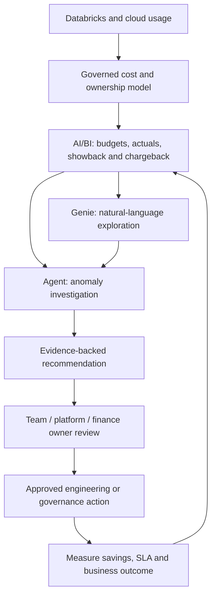

# Closing the FinOps Gap: Using Serverless, AI/BI, Genie and Agentic AI to Control Cloud Costs

*An engineering-led approach to cost visibility, team accountability, chargeback and actionable FinOps across Databricks workloads.*

**Platform scope:** This article focuses on Databricks as the data and AI platform, with cost visibility designed to extend across Azure, AWS and Google Cloud. Azure Cost Management scheduled exports and Databricks system tables provide the first implementation path. The principles apply more broadly, but billing semantics, serverless availability, SKUs, pricing and telemetry vary by cloud, region and product.

**Target audience:** Data Engineering Leads, Databricks Architects, Platform Engineers, FinOps Practitioners, Finance Partners, AI/ML Engineers and Technology Leaders.

**How to read the examples:** Cost scenarios are illustrative. The article focuses on the FinOps solution and operating model. Detailed ingestion pipelines, the common data model, allocation logic, dashboard definitions, Genie configuration, Agent implementation and deployment assets belong in an optional companion GitHub starter kit.

> **Core principle:** FinOps is not complete when an organization can see its cloud bill. It becomes effective when teams can understand what they consume, connect that consumption to business ownership, act on cost leakage, and measure whether those actions improve outcomes. Serverless, AI/BI, Genie and Agentic AI can help close those gaps when they are built on trusted cost and usage data.

------------------------------------------------------------------------

## 1. The FinOps Challenge: From Cost Visibility to Cost Accountability

Most organizations can tell how much they spent on their data platform last month. Far fewer can answer, with confidence, which teams and workloads drove that spend, whether the consumption was justified, which budgets are at risk, and who is accountable for addressing the variance.

The problem is not simply a lack of billing data. It is the gap between financial information and engineering action.

A typical platform may have Databricks billing records, cloud-provider invoices, job and query telemetry, model usage, project budgets and team ownership information spread across different systems. Finance sees the invoice. Platform teams see compute usage. Data engineering teams see jobs and pipelines. AI teams see model requests and tokens. These views are individually useful, but they do not automatically create a shared understanding of cost.

That gap leads to familiar FinOps problems:

- Costs are reported centrally, but the consuming team is unclear.
- Teams receive a monthly cost figure without enough workload-level context to explain it.
- Budgets are defined by project or cost centre, while usage is recorded by workspace, SKU or resource.
- Shared compute and platform services are difficult to allocate fairly.
- Serverless and classic compute decisions are made without a consistent cost/performance comparison.
- GenAI and Agentic AI consumption is not connected to the application or team that initiated it.
- Cost anomalies are discovered after the billing period, when the opportunity to intervene has passed.
- Optimization recommendations are identified but are not assigned, reviewed or measured.

The objective of a FinOps solution is to bridge these gaps—not merely to produce another cost report.

### Four Capabilities That Make FinOps Actionable

The solution brings together four complementary capabilities:

| Capability | Role in the FinOps solution |
|---|---|
| Serverless and classic compute | Provide distinct consumption dimensions that can be attributed to workloads, teams and budgets |
| AI/BI dashboards | Provide a trusted view of actuals, budgets, trends, ownership, allocations and exceptions |
| Genie | Let stakeholders explore governed cost and usage information using natural language |
| Agentic AI | Investigate anomalies, connect cost signals to likely causes, and recommend corrective actions for human review |

These capabilities are not competing products or separate FinOps initiatives. They form a connected operating model: measure consumption, make it understandable, assign accountability, investigate exceptions and follow through on actions.

### Serverless and Classic Compute: Make the Mix Visible and Accountable

Serverless and classic compute are complementary operating models, not competing FinOps philosophies. Serverless can help reduce avoidable provisioned capacity and infrastructure-management overhead for suitable workloads. Classic compute remains important for workloads that require specific configuration, control or runtime characteristics, and can be economically appropriate when capacity is consistently utilized.

The detailed engineering decision—when to choose serverless, when to retain classic compute, and how to benchmark their cost and performance—is covered in the companion article **“Beyond DBUs: Understanding and Optimizing the True Cost of Azure Databricks.”** This article takes the next step: making the consumption mix visible by workspace, workload, environment and accountable team, so that the organization can understand who is using each model, how spend is changing, and whether the choice aligns with the approved budget.

Serverless should therefore appear in the FinOps model as both an optimization opportunity and a consumption dimension that must be attributed. It should not be assumed to be cheaper in every situation, nor should classic compute be treated as waste by default.

------------------------------------------------------------------------

## 2. The Seven FinOps Gaps That Create Cost Leakage

Cost leakage is often not one dramatic failure. It is the accumulation of small visibility, allocation and governance gaps that prevent teams from seeing and correcting inefficient consumption.

### Gap 1: Billing Data Is Available, but the Business Context Is Missing

A billing record can identify a workspace, SKU and usage period. That may not tell finance which product, project, business unit or team should own the cost. Without a consistent mapping between technical resources and business ownership, platform spend remains centralized and difficult to explain.

### Gap 2: Compute Consumption Is Visible, but Its Business Context Is Not

A platform may report serverless and classic usage by workspace or SKU without showing which product team, application or budget owner is responsible. Without that context, the organization cannot tell whether a change in the compute mix is expected, whether it belongs to an approved initiative, or which team should investigate a material variance. The compute-selection and workload-benchmarking methods belong in the engineering optimization discussion; this solution focuses on attribution and accountability.

### Gap 3: Budgets and Actual Consumption Use Different Dimensions

Budgets may be created by cost centre, project or application, while actual consumption is recorded by workspace, SKU, job, endpoint or cloud resource. If these dimensions are not mapped, budget-versus-actual reporting becomes incomplete and budget owners cannot identify the source of a variance.

### Gap 4: Shared Platform Costs Are Not Allocated Transparently

Shared SQL Warehouses, clusters, networking, storage and platform services may support several teams. Charging all of that cost to one team is unfair; leaving it entirely in a central platform budget hides the true cost of consumption. Organizations need documented allocation rules and a visible unallocated category for costs that cannot yet be attributed reliably.

### Gap 5: GenAI and Agentic AI Usage Is Detached from Application Ownership

Model requests, tokens, Genie interactions and agent tool calls may be visible in technical telemetry, but that information is not useful for chargeback unless it can be connected to the application, environment, project or team responsible for the workload. Token counts alone also do not represent the complete cost of an AI task.

### Gap 6: Cost Anomalies Are Identified Too Late

Monthly invoices are essential for reconciliation, but they are not an operational alerting mechanism. Unexpected increases in serverless consumption, warehouse activity, model calls, retries or supporting services should be visible during the period in which teams can still investigate them.

### Gap 7: Findings Do Not Become Owned Actions

A dashboard may show that a workload is expensive. A report may identify that a team is over budget. Unless a person is assigned to investigate, a recommendation is reviewed, and the result is measured, the insight does not close the FinOps loop.

The solution must therefore connect cost data to ownership, budget controls and a repeatable action process.

------------------------------------------------------------------------

## 3. Step 1: Establish a Unified Cost and Usage Foundation

The first step is to bring financial and operational signals into a common reporting foundation. The goal is not to force every source into one artificial cost measure. It is to make the measures comparable where appropriate, preserve their financial meaning, and connect them to business ownership.

### Pattern 1: Bring Reconciled Platform and Cloud Costs into One FinOps View

The solution should consume the relevant Databricks billing and usage information together with cloud-provider financial data. For an Azure-first implementation, Databricks system tables provide platform usage context and scheduled Azure Cost Management exports provide the provider-side financial view. The same common reporting approach can be extended to AWS Data Exports and Google Cloud Billing exports, while retaining each provider's billing semantics, discounts, credits, commitments and currencies.

The important design principle is to preserve the meaning and lineage of every measure:

- Usage quantities, DBUs and tokens are consumption measures, not monetary costs.
- List-price calculations are estimates, not necessarily contracted or invoiced amounts.
- Provider-reported billing values retain the provider's financial semantics.
- Shared-resource allocations are derived values and must be labelled as allocations, not direct charges.

Do not add together measures that represent the same underlying expenditure. The detailed Databricks usage interpretation and Azure cost-reconciliation considerations are covered in Blog 1; the companion starter kit can implement the ingestion and normalization required for this broader accountability model.

### Pattern 2: Bring Workload and AI Usage Context into the Same View

Billing data explains what was charged. Operational telemetry helps explain what was running when the charge occurred.

Useful context can include:

- Job, job run, pipeline, notebook and workspace identifiers.
- SQL Warehouse and query activity.
- User, service principal and execution identity.
- Compute type, SKU and workload category.
- Model, endpoint, application and AI Gateway request metadata.
- Agent session, task, tool and retry information where instrumented.
- Environment, project, team and cost-centre ownership.

For Genie, distinguish Genie LLM consumption from the SQL Warehouse compute used to execute Genie-generated queries. They are separate cost components and should not be presented as one source charge.

For model traffic routed through AI Gateway / Unity Gateway, `system.ai_gateway.usage` can provide request, model/service, token, latency, status and tag information, subject to the configured routing path and feature availability. It does not represent every possible external model call unless that traffic is routed through the tracked gateway.

### Pattern 3: Make Ownership Metadata a Platform Standard

Chargeback cannot be reliable if ownership is optional, inconsistent or inferred after the bill arrives. Establish a minimum set of business dimensions and apply them consistently to workspaces, jobs, compute resources, model endpoints and applications where supported.

Typical dimensions include:

- Business unit or department.
- Team or cost-centre owner.
- Project, product or application.
- Environment (development, test, production).
- Workspace, job, pipeline or compute resource.
- Model endpoint or Agent application.
- Cloud account, subscription or project.

Missing or invalid ownership should be reported as **unallocated cost**. Do not silently assign unknown spend to the platform team or distribute it evenly without an agreed policy.

### Pattern 4: Preserve the Difference Between Direct, Shared and Unallocated Cost

Not every cost can be traced to one team at the source. The data foundation should classify costs according to the strength of attribution:

| Cost classification | Meaning | Treatment |
|---|---|---|
| Direct | Usage can be reliably linked to a team, workload or application | Attribute to the identified owner |
| Shared | A resource supports multiple teams or workloads | Allocate using a documented, explainable driver |
| Unallocated | Ownership or usage evidence is insufficient | Keep visible, assign an owner to resolve the gap, and do not disguise it as direct cost |

Possible allocation drivers include measured usage, query execution time, DBU consumption, storage consumed, request volume or another metric that reasonably reflects consumption. The allocation driver should match the resource being shared. Equal allocation is appropriate only when the organization has explicitly accepted it as a policy—not as a substitute for missing telemetry.

The common data model, provider-specific ingestion and allocation calculations are implementation assets. They belong in the companion GitHub starter kit, allowing customers to adapt the model to their own account structure, cost centres and governance requirements.

------------------------------------------------------------------------

## 4. Step 2: Turn Cost Visibility into Budget Control and Team Chargeback

A FinOps dashboard should not stop at showing expenditure. It should connect actual consumption to approved budgets, identify who is accountable, and provide a defensible basis for showback or chargeback.

### Principle 1: Establish Budget-versus-Actual Visibility

Budgets should be represented at the level where the organization makes financial decisions: business unit, cost centre, project, product, application or environment. Actual consumption should be mapped to those same dimensions using the ownership and allocation foundation.

A useful budget view includes:

- Approved budget for the period.
- Actual spend to date.
- Committed or forecast expenditure where available.
- Forecast month-end spend.
- Variance in currency and percentage.
- Remaining budget.
- Budget owner and accountable engineering team.
- Direct, shared and unallocated cost components.
- Top workloads and services contributing to the variance.

A budget threshold should trigger investigation, not an automatic assumption that the team is wasteful. A project may be over its original budget because usage increased with business demand. The important question is whether the additional consumption was expected, approved and delivering value.

### Principle 2: Implement Showback Before Enforcing Chargeback

**Showback** makes consumption and allocated cost visible to the teams responsible for it. **Chargeback** uses an agreed financial policy to assign those costs to a team's budget or cost centre.

For organizations that do not yet have reliable ownership and allocation data, begin with showback. Validate the resource-to-team mapping, review shared-cost allocation rules with finance and engineering, and resolve material unallocated spend before using the figures for formal chargeback.

A practical progression is:

1. **Visibility:** report direct usage and identify missing ownership.
2. **Showback:** publish team-level consumption and indicative allocated cost.
3. **Validation:** review allocation drivers, shared services and exceptions with budget owners.
4. **Chargeback:** apply the approved allocation policy to financial reporting or internal budgets.
5. **Continuous review:** reconcile allocations, update ownership and measure the effect of optimization actions.

Chargeback should be explainable and repeatable. Teams must be able to understand which resources were charged, which costs were directly attributed, which were allocated, and what allocation driver was used.

### Principle 3: Make Budget Exceptions Actionable

A budget alert should provide enough context to start an investigation:

- Which budget or cost centre is affected?
- Which team owns it?
- What changed compared with the baseline?
- Which workloads, compute products or AI applications contributed?
- Is the increase direct, shared or unallocated?
- Is the variance caused by expected business growth, a one-off event or potentially inefficient usage?
- Who is responsible for the next action and by when?

This is where AI/BI and Agentic AI move FinOps from retrospective reporting towards an operational discipline.

------------------------------------------------------------------------

## 5. Step 3: Make FinOps Actionable with AI/BI, Genie and Agentic AI

The solution has three complementary interaction layers. Each has a distinct responsibility and should be built on the same governed cost and usage foundation.

- **AI/BI dashboards — Inform:** show what is happening, where the budget is going and who owns the consumption.
- **Genie — Explore:** allow users to ask questions and understand the drivers behind the numbers.
- **Agentic AI — Investigate and recommend:** correlate signals, explain anomalies and propose actions for human review.

### Principle 1: Inform — AI/BI Dashboards as the FinOps Control Tower

AI/BI dashboards should be the primary reporting interface for engineering leaders, platform owners, finance partners and team managers. They should support both enterprise-level oversight and team-level accountability.

#### Dashboard 1: Executive FinOps Overview

Show total spend, budget utilization, forecast, variance, month-over-month trends, top cost contributors and unallocated expenditure. Provide drill-down by cloud, workspace, business unit, cost centre, project and environment.

#### Dashboard 2: Team Showback and Chargeback

Show each team's direct consumption, shared-cost allocation, unallocated exceptions, budget, actuals, forecast and variance. Make the allocation method visible. Allow budget owners to drill from a cost-centre figure into the workloads and services that contributed to it.

#### Dashboard 3: Serverless and Classic Compute Consumption

Show the serverless/classic consumption mix by workspace, workload, environment, team and cost centre where attribution is supported. Highlight material changes in spend, consumption without an identified owner, and budget variances associated with each compute model. Link engineering teams to the workload-level diagnostic process described in Blog 1 rather than duplicating compute-tuning guidance in this dashboard design.

#### Dashboard 4: GenAI and Agentic AI FinOps

Show Genie usage, model and gateway consumption, token and request trends, Agent sessions and tasks where instrumented, tool calls, retries, latency and success rates. Connect the usage to application, project and team ownership. Keep Genie LLM usage separate from the SQL Warehouse compute used by Genie-generated queries. Include the FinOps Agent's own model consumption, gateway requests, tool calls and supporting compute in the same view; the mechanism used to identify cost leakage must not become an unmeasured cost centre.

#### Dashboard 5: Budget Leakage and Exceptions

Surface budget threshold breaches, unexpected consumption changes, cost without ownership, growing spend without a corresponding increase in workload output, repeated retries and unresolved recommendations. Include an owner, review status and action date so exceptions do not become passive charts.

Every dashboard should identify data freshness and distinguish actual provider-reported cost, DBU/list-price estimates, direct attribution and allocated cost. This is essential if the same information is used by finance for internal chargeback.

### Principle 2: Explore — Genie as the Natural-Language FinOps Interface

Genie makes governed cost and usage information accessible to stakeholders who should not need to know the underlying table structure or write SQL for every question.

Example questions include:

- Which teams are above 80% of their monthly budget, and what is driving the variance?
- Show direct, shared and unallocated cost for each cost centre this month.
- How has serverless and classic consumption changed by team, project and environment?
- Which teams have the largest unallocated or unexplained compute-cost movements?
- How much Genie LLM usage did each application generate, and what was the associated SQL Warehouse compute consumption?
- Which Agentic AI applications have the largest budget variance, and who owns them?
- Which teams have AI usage that is not mapped to an owner or cost centre?
- What are the largest unexplained cost movements compared with last month?

The Genie experience must use governed definitions for budget, actual cost, list-price estimate, direct cost, allocated cost, unallocated cost, workload success and forecast. Otherwise, different users may receive answers that appear comparable but are based on different calculations.

Genie does not replace the financial model or budget policy. It makes the approved definitions easier to query and understand.

### Principle 3: Investigate — Agentic AI as a FinOps Analyst

An Agent can take a user-selected exception or detected anomaly and investigate it across cost, billing and operational context.

For example, a team may exceed its monthly AI application budget. The Agent can:

1. Identify the budget, team and application affected.
2. Compare actual usage with the historical baseline and expected workload volume.
3. Break down model requests, token consumption, latency and retries.
4. Correlate requests with Agent sessions, tool calls and SQL execution where telemetry is available.
5. Check whether ownership tags and cost-centre mappings are present.
6. Distinguish a genuine increase in business demand from unusual or potentially inefficient usage.
7. Summarize the evidence, uncertainty and likely cost drivers.
8. Recommend investigation or optimization steps and assign the finding for human review.

Other investigations may include a material change in serverless or classic consumption, an increase in shared-service expenditure, AI usage without application ownership, or a large unallocated cloud cost. Where the likely cause is a compute configuration or workload-efficiency issue, the Agent should link the finding to the engineering owner and the diagnostic guidance rather than inventing a cost-saving claim from billing data alone.

The Agent should not claim certainty where source data is incomplete. It should identify which evidence supports the finding, what remains unknown and whether the cost is directly attributed or allocated.

### Principle 4: Recommend — Human-Approved Actions Close the Loop

The initial FinOps Agent should be recommendation-only. It can propose actions such as:

- Route a material serverless/classic cost-mix change to the workload owner for engineering review.
- Assign an owner to unexplained spend or a material budget variance.
- Route a change in serverless/classic consumption to the relevant engineering owner for workload-level assessment.
- Flag AI applications with unusual request, token, retry or tool-call growth for application-owner review.
- Review model usage attribution and application-to-team mappings.
- Add missing ownership metadata or correct a cost-centre mapping.
- Revisit a shared-cost allocation driver with finance and platform owners.
- Review budget thresholds or forecast assumptions.

It should not autonomously resize compute, terminate resources, modify jobs, change model routing or alter financial allocations. Those actions require the relevant engineering or finance owner to review and approve them.

Each recommendation should include the affected owner, evidence, likely cause, proposed action, expected impact where supportable, confidence, limitations and review status. After the approved action is implemented, the dashboard should measure whether the cost, performance and business outcome changed as expected.

### The FinOps Intelligence and Accountability Loop

This is the essential FinOps feedback loop: visibility creates understanding; attribution creates accountability; investigation creates actionable recommendations; and measurement confirms whether the intervention worked.

------------------------------------------------------------------------

## 6. Moving from Cost Visibility to Financial Accountability

A reusable FinOps solution should be introduced in stages. The sequence matters: formal chargeback and AI-driven investigation are only as credible as the cost data, ownership mappings and allocation policies beneath them.

### Stage 1 — Establish Trusted Financial Measures

Agree on the financial sources of truth, billing periods, currencies and reconciliation boundaries. Keep provider-reported charges, Databricks usage estimates and derived allocations distinguishable. Confirm data freshness and document known coverage gaps.

### Stage 2 — Connect Consumption to Business Ownership

Create and maintain mappings between cloud accounts, workspaces, workloads, applications, teams, projects and cost centres. Make missing ownership visible as unallocated cost. Do not silently assign unknown spend to a central platform team.

### Stage 3 — Pilot Showback and Validate Allocation Rules

Publish consumption and indicative cost views to a small set of teams. Separate direct from shared expenditure, expose the allocation driver for each shared service, and review the results with engineering and finance. Correct mappings and allocation rules before treating the numbers as formal internal charges.

### Stage 4 — Introduce Approved Chargeback and Budget Controls

Once the showback model is trusted, apply the organization's approved financial policy. Align actuals, budgets and forecasts to the same business dimensions. Define thresholds, exception ownership, review cadence and a process for disputing or correcting allocations.

### Stage 5 — Add AI-Assisted Exploration and Investigation

Use AI/BI dashboards as the standard reporting surface, Genie as the natural-language interface to governed metrics, and Agentic AI to investigate exceptions and recommend next steps. Start with read-only investigation and human approval. Track whether accepted actions reduce avoidable expenditure without harming service levels or business outcomes.

This progression prevents a common failure mode: automating explanations or chargeback before the underlying financial and ownership model is reliable.

------------------------------------------------------------------------

## 7. Summary and Key FinOps Principles

The challenge for modern data and AI platforms is no longer just collecting billing records. It is connecting those records to workloads, business ownership, budgets and engineering decisions.

Serverless and classic compute provide different consumption models whose financial impact must be visible and attributable. The detailed engineering choice between them belongs in Blog 1. This article focuses on what happens after consumption is recorded: AI/BI dashboards expose budgets and ownership, Genie makes governed FinOps metrics accessible, Agentic AI investigates exceptions, and showback/chargeback connects platform expenditure to accountable teams.

The operating model is:

- **Measure:** combine Databricks usage, cloud billing and operational telemetry without double counting.
- **Attribute:** connect consumption to teams, projects, applications and cost centres.
- **Inform:** use AI/BI dashboards for budget-versus-actual, showback, chargeback and exception visibility.
- **Explore:** use Genie to query governed FinOps information in natural language.
- **Investigate:** use Agentic AI to correlate anomalies with workload and operational evidence.
- **Act:** route recommendations to accountable owners and require human approval.
- **Validate:** measure the impact on cost, performance, reliability and business outcomes.

The key principles are:

1. **Serverless and classic are complementary consumption models.** Attribute and report both accurately; use engineering workload analysis to decide where each belongs.
2. **Cost visibility must include business context.** Billing records without workload and ownership dimensions are not enough for actionable FinOps.
3. **Budgets and actuals must use compatible dimensions.** Map consumption to the business units, projects and cost centres that own the budget.
4. **Chargeback must be transparent.** Separate direct, shared and unallocated cost, document allocation drivers and validate showback before formal financial allocation.
5. **GenAI and Agentic AI need application-level accountability.** Connect model and tool consumption to the team and business workload that initiated it.
6. **AI/BI, Genie and Agentic AI have distinct roles.** Dashboards inform, Genie explores governed metrics, and Agents investigate and recommend.
7. **Recommendations must lead to owned actions.** Human approval and post-action measurement are part of the FinOps process.
8. **The data model should be reusable and extensible.** Provider-specific billing ingestion should feed a common reporting model without erasing cloud-specific financial semantics.

The question should move beyond:

> "How much did the platform spend last month?"

A mature FinOps practice should be able to answer:

> "Which teams consumed the budget, what workloads drove the cost, what portion is direct or shared, and what action will prevent avoidable leakage?"

And:

> "Which budget variances are explainable, which costs remain unallocated, and which accountable owner should act next?"

------------------------------------------------------------------------

## References and Further Reading

The following official references support the Databricks usage, AI consumption and cloud billing concepts discussed in this article. Validate current product availability, pricing and billing semantics before using them for financial decisions.

### Databricks Billing and Compute

- [Monitor the cost of serverless compute](https://learn.microsoft.com/en-us/azure/databricks/admin/system-tables/serverless-billing)
- [Monitor costs using system tables](https://learn.microsoft.com/en-us/azure/databricks/admin/usage/system-tables)
- [Billable usage system table reference](https://learn.microsoft.com/en-us/azure/databricks/admin/system-tables/billing)
- [Databricks pricing](https://learn.microsoft.com/en-us/azure/databricks/resources/pricing)
- [Serverless compute](https://learn.microsoft.com/en-us/azure/databricks/compute/serverless)

### Genie and AI Usage

- [Monitor and understand your Genie cost](https://learn.microsoft.com/en-us/azure/databricks/genie/monitor-cost)
- [Genie consumption guide](https://learn.microsoft.com/en-us/azure/databricks/genie/consumption-guide)
- [Track model usage with AI Gateway](https://learn.microsoft.com/en-us/azure/databricks/ai-gateway/usage-tracking)

### FinOps and Cloud Billing

- [Databricks cost management tools](https://learn.microsoft.com/en-us/azure/databricks/admin/usage/)
- [Azure Cost Management exports](https://learn.microsoft.com/en-us/azure/cost-management-billing/costs/tutorial-export-acm-data)
- [AWS Data Exports](https://docs.aws.amazon.com/cur/latest/userguide/what-is-data-exports.html)
- [Google Cloud Billing export to BigQuery](https://cloud.google.com/billing/docs/how-to/export-data-bigquery)

---

*End of article.*

---

## Companion GitHub Starter Kit (Optional)

The article describes the FinOps solution and operating model. A companion GitHub repository can provide a practical starter kit for customers who want to adapt the approach to their own Databricks and cloud environments.

The repository can contain:

- A reusable FinOps data model for Databricks usage, cloud billing, budgets, ownership and allocation.
- Azure-first scheduled billing-export ingestion, with clear extension points for AWS and Google Cloud billing sources.
- Reference mappings for workspaces, workloads, teams, projects and cost centres.
- Direct, shared and unallocated cost treatment, including configurable allocation drivers.
- AI/BI dashboard assets for executive visibility, budget-versus-actuals, team showback/chargeback, serverless/classic consumption attribution and GenAI/Agentic AI usage.
- Genie configuration and governed FinOps metric definitions.
- A recommendation-only Agent workflow for cost anomaly investigation.
- Deployment and configuration assets that customers can adapt to their own governance model.

The starter kit should be a reference implementation, not a prescriptive financial policy. Customers will need to map their own account structures, budget hierarchy, negotiated rates, tagging standards, allocation rules and approval process.

**GitHub repository:** Add the public repository link when the starter kit is published.
